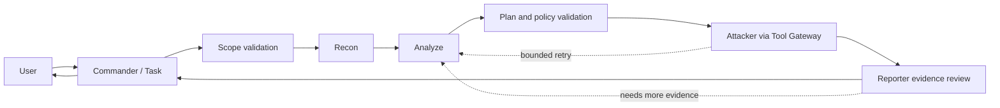

# HackMate workflow and state model (M1 draft)

## Intended first workflow

Stage order and retry edges are controlled by Python. Agent text never causes a direct stage transition by itself.

## Task states

`CREATED`, `VALIDATING_SCOPE`, `RECON_RUNNING`, `ANALYZE_RUNNING`, `ATTACK_RUNNING`, `REPORT_RUNNING`, `COMPLETED`, `PARTIAL`, `BLOCKED`, `FAILED`, `CANCELLED`.

Every transition records old/new state, reason, timestamp, actor, and related task/run ID. A finding can be `accepted` only after Reporter review; task completion may include partial, blocked, or inconclusive results.

## Failure and retry policy (contract-level)

- Schema-invalid output: reject and allow a bounded format-repair attempt; retain invalid response for diagnostics with secrets redacted.
- Transient infrastructure failure: retry only within configured count/time budget; do not repeat a potentially side-effecting action automatically.
- Missing evidence: Reporter returns `needs_more_evidence`; Commander may request a bounded Analyze/Attacker cycle.
- Scope denial, budget exhaustion, user cancellation: stop execution and record the reason.
- Restart recovery: reload task state and last completed stage before resuming; never infer success from an interrupted run.

The current implementation persists tasks, transitions, runs, token usage, result history, and Scope Gate request/DNS state in SQLite. The same per-task gate is reused across stages and recovery, so stage changes do not reset request or per-minute quotas; scope-only validation does not consume a request. Role calls apply bounded schema repair and retry transient model transport errors within the configured retry budget; tool execution is not replayed after an uncertain Attacker interruption. Attacker requests one tool action per round, verifies the tool against both the adapter allowlist and Analyze plan, and records execution evidence. Reporter `needs_more_evidence` may start a bounded Analyze/Attacker/Reporter retry cycle; the current defaults are three Attacker rounds and one workflow retry, with hard caps in code. XSS verification state is task-scoped, and cached results cannot confirm a new task without its own evidence. Time/token/request budgets, cooperative cancellation and explicit recovery are enforced. An accepted Reporter result now requires independently loaded evidence, repeatability, false-positive checks and finding details; the current XSS gate additionally checks matching raw request/response input and a CDP JavaScript execution event. The workflow stores a schema-checked Finding plus a best-effort redacted Writeup in the evidence repository. Offline workflow Eval fixtures cover scope denial, shared quotas, mandatory Reporter review, Writeup generation and safe recovery. Real-model, live-browser and authorized-target end-to-end behavior remain unverified. DNS answers are checked for changes but are not pinned to the network transport.

## Optional Research capability (governance foundation)

Research is a Commander-triggered capability, not a sixth free-running Agent. Trigger it when the current skill cannot handle a context or bounded attempts fail. `ResearchRepository` and the Web controls enforce proposed → same-task controlled validation evidence → regression/hidden Eval → explicit human approval → existing Skill improver → Skill before/after Eval gate. A research source artifact cannot double as validation proof. Failed validation or candidate Eval rejects the candidate; no direct Skill write is exposed. NVD results are captured as source evidence. Skill Eval browser URLs are prechecked against Scope Gate, redirects remain intercepted, and Skill updates require IMPACT authorization. Research promotion requires an existing Skill variant and both regression and hidden Eval groups, so vulnerability families without those artifacts remain unavailable. This flow is offline-tested; real-model, browser and authorized-target execution still need integration validation.
